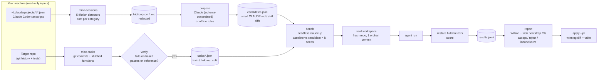

# Harness Autotune

[](https://github.com/Yuttakarn2545/harness-autotune/actions/workflows/ci.yml)

**Change your `CLAUDE.md`, and get numbers that show whether it helped.**

Harness Autotune is a closed loop for your Claude Code setup (`CLAUDE.md`, skills). It mines friction from your own transcripts, proposes small config edits, benchmarks each edit against the unchanged baseline on **sealed tasks mined from your own repo**, and keeps only the edits that win on held-out tasks. A winning edit ships as a PR with a before/after table.

```
traces ──► friction report ──► candidate edits ──► sealed A/B bench ──► held-out verdict ──► PR
```

You can already find most of these pieces separately: posts on mining session logs, `/insights`, task-mining benches, observability dashboards. As far as I know, no tool joins them into one **verified** loop, where every config change has to pay for itself on tasks it was not tuned on.

---

## How it works



| Stage | What it does | Key detail |
|---|---|---|
| `mine-sessions` | Parses Claude Code JSONL transcripts and finds **repeated failing commands, re-reads of unchanged files, user corrections (English + Thai), "done" without running tests, token-heavy turns** | Usage is counted once per `message.id`, because Claude Code writes one line per content block and repeats the usage on each. Paths, emails and secrets are redacted before anything is written. |
| `mine-tasks` | **git tasks**: commits that change both tests and source; base = parent, instruction = commit message, hidden tests = the commit's test files. **stub tasks** (SWE-smith style): a function the test suite calls gets its body replaced with `throw`; the agent re-implements it from its signature and call sites | Every task is checked: hidden tests must **fail on the sealed base and pass with the reference**, otherwise it is dropped. The source repo is opened read-only (`git archive` / `git show`). |
| Sealing | Each run gets a brand-new repo: snapshot + overlay, hidden tests removed, **one orphan commit** with a fixed author and date, no remotes, no packs | Agents read `git log` and reflogs to find the answer (cf. agentbench-local, Claw-SWE-Bench). An audit (`auditSeal`) checks this, and any run whose tool calls touch the source repo path is flagged **contaminated** and excluded. |
| `propose` | Claude turns the friction report and the current `CLAUDE.md` into ≤ N candidate edits, validated against a schema (append to `CLAUDE.md`, or create a new skill; nothing else) | `--via api` uses the Anthropic SDK (`claude-opus-5-5`, adaptive thinking, structured output, server-side refusal fallback). `--via claude-cli` uses `claude -p --json-schema` with your subscription. `--offline` uses rule templates. |
| `bench` | `claude -p --output-format stream-json` in each sealed workspace, with `--setting-sources project,local`, so the variant's files are the only difference between arms | Records pass, `total_cost_usd`, tokens, turns and wall time. Results go to resumable JSONL. Prints a **cost estimate and hard cap first**, and only runs with `--yes`. |
| `report` | Before/after table (Markdown + HTML) and a verdict per candidate on the **held-out** split | Wilson 95% CI for pass rates. 95% cluster bootstrap over tasks (seeds stay together) for the Δ pass rate and the cost-per-solved ratio. |

### Acceptance rule (held-out only)

- **accept** if the pass-rate gain is significant (CI lower bound > 0), *or* the pass rate held (point ≥ 0, CI lower bound ≥ −5 pp) **and** cost per solved task fell significantly (ratio CI upper bound < 1×).
- **reject** if the pass rate dropped significantly, or the edit costs more per solved task with no pass-rate gain.
- **inconclusive** otherwise, including whenever there are fewer than 5 paired held-out tasks. Small benchmarks mostly land here. That is the honest answer, not a bug.

---

## Quick start

Requires Node ≥ 22, git, and `tar` (built into Windows 10+, macOS and Linux). For live runs, also the [Claude Code](https://claude.com/claude-code) CLI.

```bash
git clone https://github.com/Yuttakarn2545/harness-autotune && cd harness-autotune
npm ci
npm run check   # build + typecheck + 40 offline tests, no API key needed
npm run demo    # full loop on a generated repo with a scripted agent (synthetic numbers)
```

Run it on your own setup:

```bash
# 1. friction in your transcripts (stays in .autotune/, which is git-ignored)
node dist/cli.js mine-sessions --project /path/to/your/repo        # or --all --since 30

# 2. sealed tasks from the repo's history and tests
node dist/cli.js mine-tasks --repo /path/to/your/repo --limit 10

# 3. candidate edits
node dist/cli.js propose --friction .autotune/friction/friction.json --repo /path/to/your/repo --via claude-cli
#    (--via api needs ANTHROPIC_API_KEY; --offline needs nothing)

# 4. cost estimate (dry run), then the real run
node dist/cli.js bench --repo /path/to/your/repo --tasks .autotune/tasks --candidates .autotune/candidates.json --seeds 2
node dist/cli.js bench ... --yes

# 5. table + HTML, then optionally a PR with the winning diff
node dist/cli.js report --results .autotune/results.jsonl --candidates .autotune/candidates.json --repo /path/to/your/repo
node dist/cli.js apply --repo /path/to/your/repo --candidates .autotune/candidates.json --id <winner> --report .autotune/report/report.md --pr
```

`--deps copy` (the default) copies `node_modules` into each workspace and re-points workspace links into the sealed copy, so tests run against the agent's code, and writes never reach your original repo. Use `--deps "setup:npm ci"` to install fresh instead.

---

## Results

### Dogfood: friction mining on the author's own transcripts

`mine-sessions --all --since 60` over the author's real Claude Code history ran in seconds and found every category. The report itself stays private (it lives in git-ignored `.autotune/`). Only synthetic fixtures ship in this repo: [`examples/transcripts`](examples/transcripts).

<!-- friction:start -->
_Aggregate counts are pending the author's approval to publish._
<!-- friction:end -->

### Dogfood: tasks mined from [thai-receipt-ai](https://github.com/Yuttakarn2545/thai-receipt-ai)

That repo has only 4 commits and none of them change tests, so the git miner finds nothing there. That is common for young repos, and it is why the stub miner exists. The stub miner produced **8 tasks, all verified** (hidden tests fail on the sealed base and pass with the reference): `parseThaiDate`, `formatThaiDate`, `validateTaxId`, `completeTaxId`, `promptPayQr`, `checkReceipt`, plus `scoreReceipt` and `similarity` from the eval scorer. Split: 4 train / 4 held-out.

### Live bench

<!-- bench:start -->
_Not run yet. Numbers will appear here only from a real `bench --yes` run, labelled with model, seeds and date._
<!-- bench:end -->

### Offline demo (scripted agent, not a model)

`npm run demo` runs the whole loop with a scripted agent that applies the reference solution with a fixed probability: 40% for baseline, 90% when the candidate text is present. Use it to check the plumbing and the statistics. It tells you nothing about Claude.

---

## Design notes

- **Why stub tasks?** Real benchmarks need many tasks, and most personal repos don't have hundreds of test-changing commits. Stubbing functions the test suite exercises gives tasks that are solvable by construction and still verified by execution. They are easier than real feature work, so treat absolute pass rates as an upper bound. The **difference** between arms is what matters.
- **Why held-out?** Proposals are derived from your transcripts and may be iterated on the train split. Acceptance only looks at tasks the proposal never saw, the same discipline as the train/validation/test split in prompt hill-climbing.
- **Why cluster bootstrap?** Seeds of the same task are correlated. Resampling tasks, not runs, keeps a lucky task from looking like a real effect.
- **Costs.** Transcript costs are API list-price equivalents computed from each response's usage block. Bench costs are Claude Code's `total_cost_usd`. On a subscription, `claude -p` uses your plan's usage instead of money.
- **Safety.** Proposals can only append to `CLAUDE.md` or create `.claude/skills/<name>/SKILL.md`. Anything else is rejected before it runs. `apply` refuses to run on a dirty working tree and works on a new branch.

## Layout

```
src/sessions   transcript parser, friction detectors, redaction, report
src/tasks      git + stub miners, sealing, verification, splits
src/propose    candidate schema/validation, rule proposer, Claude proposer (API or claude -p)
src/bench      Claude Code agent (stream-json), scripted agent, runner, statistics
src/report     Markdown + HTML report
test/          offline tests: synthetic transcripts and generated fixture repos
```

## License

MIT
